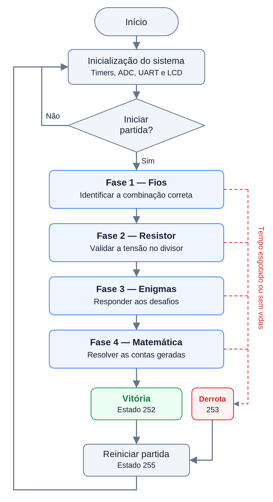

# Módulo de Desarme de Bomba — Arduino Uno R3 (ATmega328P)

Jogo interativo de desarme de bomba desenvolvido em C/C++ para **Arduino Uno R3**, combinando interação física (fios, divisor de tensão, potenciômetro, botão e buzzer) e comunicação serial em uma arquitetura embarcada com manipulação direta de registradores AVR, interrupções, timers de hardware e armazenamento em memória Flash.

## Fluxograma do Sistema

<!-- Insira aqui a imagem do fluxograma final. Exemplo:  -->

*Espaço reservado para o fluxograma da máquina de estados do firmware.*

---

## Visão Geral e Regras do Jogo

O objetivo do jogador é desarmar a bomba completando **4 módulos sequenciais** antes que o tempo acabe ou que todas as vidas sejam perdidas.

* **Início da partida:** o sistema aguarda o caractere `&` no Monitor Serial para armar a bomba e iniciar a contagem regressiva.
* **Condições iniciais:** **300 segundos (5 minutos)** de tempo total e **3 vidas**.
* **Aviso sonoro crítico:** nos **10 segundos finais**, o buzzer emite um bip curto ($2000\text{ Hz}$) a cada segundo.
* **Derrota (Explosão):** ocorre automaticamente se o cronômetro chegar a `0:00` ou se as `vidas_totais` chegarem a `0`. O sistema exibe a animação de explosão no display LCD e no Monitor Serial enquanto aciona um alarme contínuo ($500\text{ Hz}$) durante a animação e por mais 5 segundos após sua conclusão.
* **Vitória (Desarme):** ocorre ao concluir o 4º módulo dentro do tempo e com vidas restantes, desligando o cronômetro e exibindo a arte de bomba desativada no LCD e no Monitor Serial.
* **Reinício:** ao fim da partida (vitória ou derrota), o comando `r` (ou `R`) no Monitor Serial reinicia o microcontrolador via *Watchdog Timer*.

---

## Os 4 Módulos do Jogo

### Fase 1 — Fios
* **Mecânica:** o sistema sorteia aleatoriamente um entre 4 fios coloridos (conectados aos pinos `D10` a `D13`) e exibe uma charada correspondente no Monitor Serial. O jogador deve desconectar **apenas** o fio correto e pressionar o botão de confirmação.
* **Penalidade:** retirar o fio errado (ou mais de um fio) gera uma penalidade severa de **$-60\text{ s}$** e **$-1$ vida**. Em caso de erro, o jogador deve reconectar o fio antes de tentar novamente.

### Fase 2 — Divisor de Tensão (Resistor)
* **Mecânica:** o jogador recebe um conjunto de resistores misturados e precisa identificar e encaixar o resistor correto ($4{,}7\text{ k}\Omega$) no circuito divisor de tensão formado com um resistor fixo de $10\text{ k}\Omega$, confirmando pelo botão físico. Os demais resistores (preferencialmente menores que $1\text{ k}\Omega$) atuam como iscas fora da faixa válida.
* **Cálculo da faixa de validação (ADC de 10 bits):**
  $$V_{\text{out}} = 5\text{ V} \cdot \frac{4{,}7\text{ k}\Omega}{10\text{ k}\Omega + 4{,}7\text{ k}\Omega} \approx 1{,}60\text{ V} \implies \text{Leitura ADC} \approx 327$$
  Para absorver a tolerância física dos componentes, o firmware reconhece inicialmente a faixa $290 < \text{ADC} < 360$, com filtragem e histerese descritas na seção de arquitetura.
* **Penalidade:** cada tentativa com resistor errado aplica uma mini-penalidade de **$-10\text{ s}$** (sem perda direta de vida), aumentando a pressão sobre o cronômetro.

### Fase 3 — Enigmas
* **Mecânica:** o jogo embaralha um banco de **25 enigmas** armazenados na memória Flash e sorteia **5 desafios** por partida. Para cada enigma exibido no Monitor Serial, o jogador deve girar o potenciômetro para selecionar um número de `00` a `99` no display LCD e confirmar no botão físico.
* **Penalidade:** cada resposta incorreta desconta **$-10\text{ s}$** e soma **1 erro** ao contador de falhas. A cada **3 erros acumulados**, o jogador perde **1 vida**, recebe uma penalidade adicional de **2 segundos** e o contador de erros é zerado. Os erros restantes são mantidos na transição para a Fase 4.

### Fase 4 — Matemática
* **Mecânica:** última etapa do desarme. O sistema gera **10 somas aleatórias** (parcelas de $0$ a $99$) exibidas simultaneamente no LCD e no Monitor Serial. O jogador digita o resultado diretamente no teclado pelo Monitor Serial e confirma com `Enter`.
* **Penalidade:** cada resposta errada desconta **$-15\text{ s}$** e soma **1 erro** ao mesmo sistema de falhas — a cada **3 erros acumulados**, o jogador perde **1 vida**, recebe uma penalidade adicional de **2 segundos** e o contador é zerado.

| Fase | Módulo | Entrada do Jogador | Penalidade por Erro | Perda de Vida |
| :--- | :--- | :--- | :--- | :--- |
| **1** | Fios | Retirada de jumper + Botão (`INT0`) | $-60\text{ s}$ | Direta ($-1$ vida por erro) |
| **2** | Resistor | Divisor de tensão + Botão (`INT0`) | $-10\text{ s}$ | Não retira vida diretamente |
| **3** | Enigmas | Potenciômetro + Botão (`INT0`) | $-10\text{ s}$ | $-1$ vida e $-2$ s adicionais a cada 3 erros |
| **4** | Matemática | Teclado via Monitor Serial | $-15\text{ s}$ | $-1$ vida e $-2$ s adicionais a cada 3 erros |

---

## Lista de Materiais (BOM)

* 1x **Arduino Uno R3** (ATmega328P)
* 1x **Display LCD 20x4** com módulo conversor **I2C** (endereço `0x27`)
* 1x **Buzzer passivo** (+ 1x resistor de $100\text{ }\Omega$ a $220\text{ }\Omega$ em série para proteção do pino)
* 1x **LED verde** (como indicador de progresso)
* 1x **Potenciômetro** (para seleção de `00` a `99` na Fase 3)
* 1x **Push-button** (botão de confirmação)
* 1x **Resistor fixo de $10\text{ k}\Omega$** (base do divisor de tensão)
* 1x **Resistor alvo de $4{,}7\text{ k}\Omega$** (resposta correta da Fase 2)
* **Resistores aleatórios diversos** (preferencialmente $< 1\text{ k}\Omega$, usados como opções incorretas na Fase 2)
* **4 fios coloridos** para o módulo da Fase 1 (cores correspondentes às charadas: vermelho, amarelo, laranja e roxo)
* **Protoboard e jumpers diversos**

---

## Pinagem e Ligações de Hardware

| Pino Arduino | Registrador AVR | Componente / Função | Configuração Elétrica |
| :--- | :--- | :--- | :--- |
| **D0 / D1** | `PD0` / `PD1` | UART / Monitor Serial | $9600\text{ baud}$ |
| **D2** | `PD2` (`INT0`) | Botão de confirmação | Entrada com pull-up interno (ativo em `LOW`) |
| **D9** | `PB1` (`OC1A`) | Buzzer passivo | Saída controlada por hardware via Timer1 |
| **D10** | `PB2` | Fio 1 (Vermelho) | Entrada com pull-up interno (inicia no `GND`) |
| **D11** | `PB3` | Fio 2 (Amarelo) | Entrada com pull-up interno (inicia no `GND`) |
| **D12** | `PB4` | Fio 3 (Laranja) | Entrada com pull-up interno (inicia no `GND`) |
| **D13** | `PB5` | Fio 4 (Roxo) | Entrada com pull-up interno (inicia no `GND`) |
| **A0** | `PC0` (`ADC0`) | Potenciômetro (Fase 3) | Entrada analógica (buffer digital desabilitado via `DIDR0`) |
| **A1** | `PC1` (`ADC1`) | Divisor de tensão (Fase 2) | Entrada analógica (buffer digital desabilitado via `DIDR0`) |
| **A2** | `PC2` (`ADC2`) | Pino flutuante (ruído) | Entrada analógica usada como semente de aleatoriedade |
| **A4 / A5** | `PC4` / `PC5` | Display LCD 20x4 I2C | Barramento I2C (`SDA` / `SCL`, endereço `0x27`) |

**Observações importantes de montagem:**
1. Todos os **4 fios da Fase 1** devem iniciar conectados ao `GND`. Ao desconectar apenas o fio sorteado, o resistor de pull-up interno eleva o bit correspondente em `PINB` para `1`.
2. O pino **A2** deve permanecer fisicamente desconectado para captar ruído elétrico ambiente na inicialização do gerador pseudoaleatório.

---

## Arquitetura e Diferenciais Técnicos do Firmware

O código foi escrito priorizando baixo consumo de memória RAM, previsibilidade de tempo e controle direto dos periféricos do ATmega328P:

* **Gerenciamento de Memória Flash (`PROGMEM` e `F()`):** o Arduino Uno possui apenas $2\text{ KB}$ de SRAM. Para evitar estouro de memória, todo o dicionário de 25 enigmas, as charadas dos fios, as artes ASCII do Monitor Serial e os textos fixos do LCD foram alocados na memória Flash ($32\text{ KB}$) usando `PROGMEM` e a macro `F()`. O vetor de chaves ativas (`25 bytes`), que precisa ser embaralhado em tempo de execução, permanece na SRAM, assim como as demais variáveis de execução, os buffers do ADC e a fila serial.
* **Manipulação Direta de Registradores com Máscaras:** a configuração de direção, pull-ups e periféricos utiliza macros bit a bit (`set_bit`, `clr_bit`, `tst_bit`), garantindo que alterar um pino nunca sobrescreva a configuração de outros pinos da mesma porta. Os buffers digitais dos pinos analógicos utilizados são desligados via `DIDR0` para reduzir ruído e consumo.
* **Separação Estratégica dos Timers:**
  * **Timer2 (Modo CTC — $1\text{ ms}$):** configurado com *prescaler* $64$ e `OCR2A = 249` para gerar uma interrupção exata a cada $1\text{ ms}$ (`ISR(TIMER2_COMPA_vect)`), incrementando o contador `tempo_ms`. O laço principal calcula os segundos transcorridos a partir desse contador, com leitura atômica via `ATOMIC_BLOCK`, evitando a perda de segundos por sobrescrita de flags.
  * **Timer1 (Modo CTC — Hardware Toggle no `OC1A`):** como a função padrão `tone()` do Arduino conflita com o Timer2, o buzzer passivo é acionado diretamente pelo hardware do Timer1 no pino `D9` (`COM1A0` com *prescaler* $8$), seguindo a relação:
    $$\text{OCR1A} = \frac{16\text{ MHz}}{2 \cdot 8 \cdot f} - 1 = \frac{1\,000\,000}{f} - 1$$
    Isso gera a onda quadrada sem consumir ciclos de CPU e sem usar nenhuma interrupção adicional.
* **Interrupção Externa (`INT0`) com Debounce por Software:** o botão de confirmação dispara `ISR(INT0_vect)` em borda de descida (`ISC01 = 1`, `ISC00 = 0`), limpando a flag pendente (`EIFR = (1 << INTF0)`) antes da ativação. O repique mecânico é filtrado reaproveitando a base de `tempo_ms` do Timer2 com janela de $150\text{ ms}$.
* **Leitura Direta do ADC e Aleatoriedade:** a rotina `atualizar_adc()` manipula diretamente `ADMUX` e `ADCSRA` (*prescaler* $128$, clock de $125\text{ kHz}$). A conversão é iniciada e sua conclusão é verificada em iterações posteriores do laço principal. A primeira conversão após a troca de canal é descartada. O ruído analógico do pino solto `A2` fornece uma semente para o gerador pseudoaleatório. O algoritmo **Fisher-Yates** embaralha as chaves e impede repetições de enigmas dentro da mesma partida.
* **Comunicação Serial Não Bloqueante:** a recepção processa um caractere por iteração, quando há dados e espaço suficiente na fila de saída. A transmissão utiliza uma fila de descritores de mensagens e verifica `Serial.availableForWrite()` antes de enviar os bytes, evitando esperas pela liberação do buffer de transmissão.
* **Reset Limpo via Watchdog Timer:** o reinício da partida ativa `wdt_enable(WDTO_15MS)` para resetar o hardware por completo, combinado com `MCUSR = 0; wdt_disable();` na abertura do `setup()` para evitar travamento em *bootloop*.


### Máquina de Estados e Arquitetura Não Bloqueante

O firmware utiliza `estado_atual` para controlar a espera inicial, os quatro módulos e o fim de jogo. Os subestados de `espera` controlam mensagens temporárias, transições, penalidades e animações, sem chamadas explícitas a `delay()`. A função `aguardar()` registra o instante inicial e a duração da espera; `processar_espera()` executa a próxima ação quando o intervalo termina.

O Timer2 mantém a base de tempo de 1 ms, enquanto o laço principal atualiza o ADC, o cronômetro, a comunicação serial e a máquina de estados. A primeira linha do LCD fica reservada ao tempo restante durante a partida. As condições de derrota são verificadas antes e depois das ações dos módulos. As operações internas da biblioteca LCD I2C permanecem síncronas.

### Filtragem do ADC e Histerese

Os canais A0 e A1 possuem filtros independentes de média móvel de oito amostras. A rotina percorre os três canais analógicos, com intervalo mínimo de 5 ms entre inícios de amostragem. A2 permanece sem filtragem para fornecer a semente dos sorteios.

* **Potenciômetro (A0):** mantém a escala original de 00 a 99, com saturação no extremo superior. A histerese de 2 unidades do ADC em torno das fronteiras entre números evita oscilações na resposta exibida.
* **Divisor de tensão (A1):** a entrada na faixa válida ocorre quando a leitura filtrada está estritamente entre 290 e 360. Após entrar nessa faixa, o estado permanece válido até que a leitura seja menor ou igual a 285 ou maior ou igual a 365, implementando uma margem de histerese de 5 unidades do ADC.

### Protocolo de Comunicação Serial

A comunicação utiliza UART a 9600 baud, com a configuração padrão 8N1 da biblioteca `Serial`. Os comandos de início e reinício são caracteres individuais; as respostas matemáticas são linhas de um a quatro algarismos decimais, terminadas por CR, LF ou CRLF.

| Entrada | Estado permitido | Resposta do sistema |
| :--- | :--- | :--- |
| `&` | Espera inicial | Arma a bomba e inicia a partida. |
| `r` ou `R` | Fim de jogo, após a animação | Reinicia o microcontrolador via watchdog. |
| Número + Enter | Fase 4, aguardando resposta | Informa acerto ou erro e aplica a penalidade prevista quando necessário. |
| Resposta vazia, não numérica ou com mais de quatro algarismos | Fase 4, aguardando resposta | Rejeita a linha inteira e informa o formato esperado. |
| Comando inválido | Espera inicial ou fim de jogo liberado | Informa o comando esperado. |
| Entrada fora da etapa permitida | Demais fases ou transições | Informa que a entrada está indisponível e solicita que o jogador aguarde. |

Entradas com formato inválido não recebem penalidade de tempo adicional. Terminadores de linha isolados fora da fase matemática são ignorados, e CRLF é tratado como um único terminador.

---

## Como Compilar e Executar

### Dependências
* **Arduino IDE** (1.8.x ou 2.x)
* Biblioteca **LiquidCrystal I2C** (Frank de Brabander) — instalável pelo Gerenciador de Bibliotecas da IDE.
* Bibliotecas nativas AVR/Arduino: `<avr/io.h>`, `<avr/interrupt.h>`, `<avr/pgmspace.h>`, `<avr/wdt.h>`, `<util/atomic.h>`, `<Arduino.h>` e `<Wire.h>`.

### Passo a Passo
1. Monte o circuito seguindo a tabela de pinagem acima (verifique se o endereço I2C do seu módulo LCD é `0x27`; caso seja `0x3F`, ajuste a linha `LiquidCrystal_I2C lcd(0x27, 20, 4);`).
2. Abra o arquivo `.ino` na Arduino IDE, selecione a placa **Arduino Uno** e a porta serial correta.
3. Faça o upload do código para a placa.
4. Abra o **Monitor Serial** configurado em:
   * Velocidade: **9600 baud**
   * Final de linha: **Nova-linha (`\n`)** ou **Ambos, NL e CR** *(obrigatório para o envio das respostas na Fase 4)*.
5. Digite `&` e pressione `Enter` para armar a bomba.

---

## Balanceamento e Próximos Passos

Os parâmetros atuais de dificuldade — tempo total ($300\text{ s}$), quantidade de enigmas ($5$), quantidade de contas matemáticas ($10$) e valores de penalidade ($-60\text{ s}$, $-10\text{ s}$, $-15\text{ s}$) — constituem uma **versão inicial de referência**.

Como o desenvolvedor já conhece previamente as charadas dos fios, os enigmas e a identificação física dos resistores, o balanceamento definitivo depende de **sessões de testes (*playtesting*) com jogadores externos** para calibrar o tempo médio de conclusão de cada fase e ajustar a curva de dificuldade.

### Uso de Memória

Valores registrados na compilação anterior, ainda não confirmados para o firmware final. Atualizar após a compilação definitiva.
```text
Sketch usa 15128 bytes (46%) de espaço de armazenamento para programas. O máximo são 32256 bytes.
Variáveis globais usam 494 bytes (24%) de memória dinâmica, deixando 1554 bytes para variáveis locais. O máximo são 2048 bytes.
```

## Autores

* **Arthur Citron Ribas** — Arquitetura geral, Fases 2 e 3, gerenciamento de memória Flash, timers e integração.
* **Gabriel Madeira Camargo** — Fase 4, conversores AD, protocolos de comunicação.
* **Alexandre Eger Augusto** — Fase 1, Interrupções, Configuração de GPIO e Resistores internos
* **Disciplina / Instituição:** *Arquitetura e Programação de Sistemas Microcontrolados (DAS5332) / UFSC*
